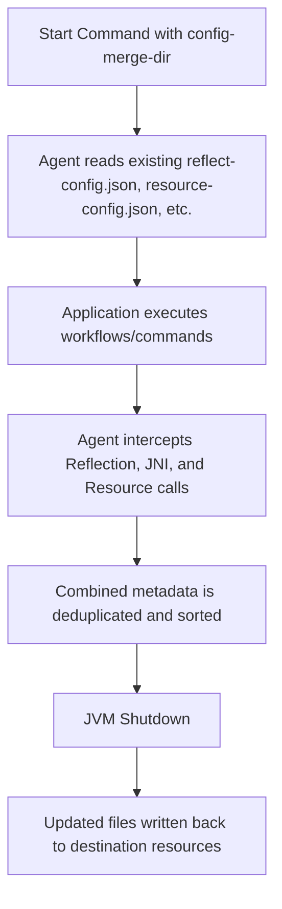

# GraalVM Tracing Agent Reference Documentation

The Native Image Tracing Agent tracks execution paths at runtime on a standard Hotspot JVM and outputs configuration files necessary for Native Image compilation.

---

## 1. Tracing Agent Configuration Files

The agent creates or updates the following files in the target directory:
*   `reflect-config.json`: Lists types, methods, and constructors accessed via Reflection APIs.
*   `resource-config.json`: Lists filenames, directories, and Java resource bundles loaded by the application.
*   `jni-config.json`: Lists types and fields accessed via Java Native Interface (JNI).
*   `serialization-config.json`: Lists classes registered for Java Serialization.
*   `proxy-config.json`: Lists interface types for which dynamic proxy instances are created.

---

## 2. Agent Options Reference

Options are passed using `-agentlib:native-image-agent=<option1>=<value1>,<option2>=<value2>`:

| Option Name | Example | Description |
| :--- | :--- | :--- |
| `config-output-dir` | `/path/to/dir` | Creates or overwrites configuration files in the target folder. |
| `config-merge-dir` | `/path/to/dir` | Appends and merges tracked items into existing files in the target folder. |
| `caller-filter-file` | `filter.json` | Restricts tracing to classes specified in a filter configuration file (prevents noise). |
| `builtin-caller-filter` | `true`/`false` | Excludes internal JDK/JVM reflection calls (defaults to `true`). |
| `experimental-predefined-classes` | `true`/`false` | Traces dynamically loaded bytecodes/lambdas. |

---

## 3. Dynamic Merging Architecture

When `config-merge-dir` is specified, the agent reads all existing configurations from the target folder, compiles them into an internal tree structure, adds newly observed reflection calls, and writes the combined, deduplicated configurations back.

