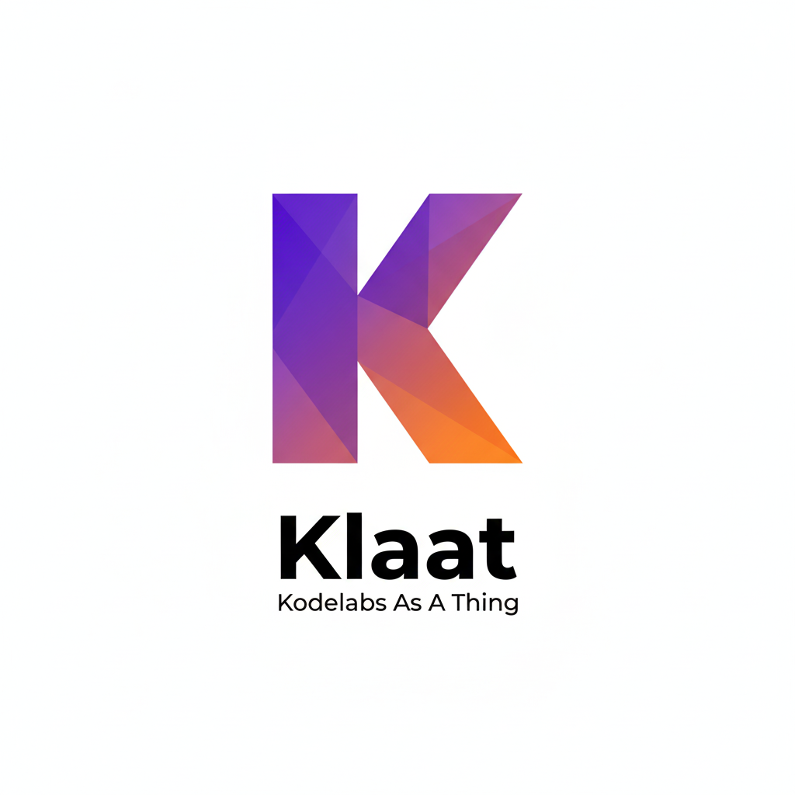

<div align="center">
  

# Klaat - Kodelabs As A Thing

**Klaat** (Kodelabs As A Thing) is a Kotlin-based CLI tool for authoring and serving interactive codelabs. This is a modern reimplementation of the archived [Google Codelabs Tools](https://github.com/googlecodelabs/tools) project.

</div>

## Features

✅ **Export codelabs** from Google Docs or Markdown files  
✅ **Multiple output formats** - HTML and Markdown  
✅ **Local preview server** with auto-browser opening  
✅ **Update existing codelabs** from their sources  
✅ **Google Analytics integration**  
✅ **Asset prefix support** for CDN hosting (Default: `https://distribute.kartikarora.me`)  
✅ **Rich formatting** - code blocks, info boxes, images, videos, surveys, and more

## Installation

> **Platform Support**: Klaat supports macOS (Apple Silicon only), Linux ARM64, and Linux x64. Intel Macs are **not supported**.

### Homebrew (Recommended for macOS & Linux)

```bash
brew tap kartikarora/klaat
brew install klaat
```

Get snapshot builds (latest from develop):

```bash
brew tap kartikarora/klaat-snapshots
brew install klaat-snapshot
```

### Download Binary

> **Alpha Status**: Klaat is currently in alpha. Stable binaries are not yet provided. Please use snapshot builds for testing.

Download the latest snapshot from the [CDN](https://distribute.kartikarora.me/):

```bash
# macOS ARM64 (Apple Silicon M1/M2/M3/M4)
curl -L https://distribute.kartikarora.me/bin/klaat/snapshot/COMMIT_HASH/klaat-snapshot-macos-arm64-COMMIT_HASH -o klaat

# Linux ARM64
curl -L https://distribute.kartikarora.me/bin/klaat/snapshot/COMMIT_HASH/klaat-snapshot-linux-arm64-COMMIT_HASH -o klaat

# Linux x64
curl -L https://distribute.kartikarora.me/bin/klaat/snapshot/COMMIT_HASH/klaat-snapshot-linux-x64-COMMIT_HASH -o klaat

# Make it executable
chmod +x klaat

# Move to PATH
sudo mv klaat /usr/local/bin/

# Verify installation
klaat version
```

### Build from Source

```bash
git clone https://github.com/kartikarora/klaat.git
cd klaat
./gradlew build
./gradlew installDist
```

The executable will be in `build/install/klaat/bin/klaat`

### Add to PATH (Optional)

```bash
# On macOS/Linux
export PATH=$PATH:$(pwd)/build/install/klaat/bin

# Or create an alias
alias klaat='$(pwd)/build/install/klaat/bin/klaat'
```

## Quick Start

### 1. Export from Markdown

Create a markdown file `tutorial.md`:

```markdown
---
id: my-first-codelab
summary: Learn how to create codelabs
categories: Tutorial
environments: Web
status: Published
authors: Your Name
---

# My First Codelab

## Introduction
Duration: 5

Welcome to your first codelab!

## Step 2
Duration: 10

More content here...
```

Export it:

```bash
klaat-snapshot export tutorial.md -o codelabs/
```

### 2. Export from Google Docs

```bash
klaat-snapshot export 1ABC-YOUR-DOC-ID -o codelabs/
```

### 3. Serve Locally

```bash
klaat-snapshot serve -d codelabs/
```

Opens `http://localhost:9090` in your browser automatically.

## Commands

### `export`

Export codelabs from Google Docs or Markdown files.

```bash
klaat-snapshot export [OPTIONS] SOURCES...

Options:
  -f, --format TEXT     Output format (html|md) [default: html]
  -o, --out TEXT        Output directory [default: .]
  -ga TEXT              Google Analytics tracking ID
  -p, --prefix TEXT     URL prefix for assets
  -h, --help            Show help

Examples:
  klaat-snapshot export 1ABC... -o codelabs/
  klaat-snapshot export tutorial.md -f html -o output/
  klaat-snapshot export doc1 doc2 doc3 -ga UA-12345-1
```

### `serve`

Start a local web server to preview codelabs.

```bash
klaat-snapshot serve [OPTIONS]

Options:
  -p, --port INT        Port to listen on [default: 9090]
  -h, --host TEXT       Host to bind to [default: localhost]
  -d, --dir TEXT        Directory to serve [default: .]
  --no-browser          Don't open browser automatically
  -h, --help            Show help

Examples:
  klaat-snapshot serve
  klaat-snapshot serve -p 8080 -d ./codelabs
  klaat-snapshot serve --no-browser
```

### `update`

Update existing codelabs from their original sources.

```bash
klaat-snapshot update [OPTIONS] [PATHS...]

Options:
  -ga TEXT              Override Google Analytics tracking ID
  -p, --prefix TEXT     Override URL prefix for assets
  -h, --help            Show help

Examples:
  klaat-snapshot update                    # Update all in current directory
  klaat-snapshot update ./codelabs         # Update specific directory
  klaat-snapshot update codelab1 codelab2  # Update specific codelabs
```

### `version`

Print the version.

```bash
klaat-snapshot version
```

## Codelab Format

### Markdown Format

Codelabs use standard Markdown with YAML frontmatter:

```markdown
---
id: unique-codelab-id
summary: Brief description
categories: Category1, Category2
environments: Web, Kiosk
status: Published
feedback_link: https://example.com/feedback
analytics_account: UA-12345-1
tags: kotlin, android
authors: John Doe, Jane Smith
---

# Codelab Title

## Step 1: Introduction
Duration: 5

Content for step 1...

### Code Example

```kotlin
fun hello() {
    println("Hello, World!")
}
```

## Step 2: Next Steps
Duration: 10

More content...
```

### Google Docs Format

See the [original format guide](https://github.com/googlecodelabs/tools/blob/master/FORMAT-GUIDE.md) for detailed instructions on formatting Google Docs.

Key elements:
- **Heading 1** - Codelab steps
- **Heading 2-4** - Section headers within steps
- **Two-column table** (at start) - Metadata
- **Single-cell table (green)** - Positive info boxes
- **Single-cell table (orange)** - Warning info boxes
- **Single-cell table (Courier New)** - Code blocks
- Duration annotations in grey text

## Features

### Supported Content Types

- ✅ Text formatting (bold, italic, code)
- ✅ Headers (H2, H3, H4)
- ✅ Paragraphs
- ✅ Code blocks with syntax highlighting
- ✅ Command/terminal blocks
- ✅ Info boxes (positive, negative, regular)
- ✅ Bullet lists
- ✅ Numbered lists
- ✅ Images
- ✅ YouTube videos
- ✅ IFrames
- ✅ Links
- ✅ Download buttons
- ✅ Surveys
- ✅ FAQ sections

### Metadata Fields

- `id` - Unique identifier
- `summary` - Brief description
- `category` - Comma-separated categories
- `environment` - Target environments (Web, Kiosk, etc.)
- `status` - Published, Draft, Deprecated, Hidden
- `feedback_link` - URL for bug reports
- `analytics_account` - Google Analytics ID
- `tags` - Comma-separated tags
- `authors` - Comma-separated author names
- `duration` - Total duration in minutes

## Google Docs Setup

### 1. Configure OAuth Credentials

Create a `gcp_credentials.json` file in the project root or in `src/main/resources/credentials/`:

```bash
# Copy the template to the root
cp gcp_credentials.json.template gcp_credentials.json

# OR copy to resources
mkdir -p src/main/resources/credentials
cp gcp_credentials.json.template src/main/resources/credentials/gcp_credentials.json
```

Then add your Google OAuth credentials:

1. Go to [Google Cloud Console](https://console.cloud.google.com/)
2. Create a new project (or use existing)
3. Enable **Google Docs API**:
   - APIs & Services → Library → Search "Google Docs API" → Enable
4. Create **OAuth 2.0 Client ID**:
   - APIs & Services → Credentials → Create Credentials → OAuth client ID
   - Application type: **Desktop app**
   - Name it "Klaat"
5. Download the credentials JSON or copy the **Client ID** and **Client Secret** to `gcp_credentials.json` (root) or `src/main/resources/credentials/gcp_credentials.json`:

```json
{
  "installed": {
    "client_id": "YOUR_CLIENT_ID.apps.googleusercontent.com",
    "client_secret": "YOUR_CLIENT_SECRET",
    "redirect_uris": ["http://localhost"],
    "auth_uri": "https://accounts.google.com/o/oauth2/auth",
    "token_uri": "https://oauth2.googleapis.com/token"
  }
}
```

**Note:** The `gcp_credentials.json` file is git-ignored for security and should be placed in the project root or `src/main/resources/credentials/`.

### 2. Build the Project

```bash
./gradlew build
./gradlew installDist
```

### 3. Authenticate

On first use with a Google Doc ID, Klaat will:

1. Open your browser for Google authentication
2. Ask you to grant read-only access to Google Docs
3. Save the access token to `~/.klaat/tokens/`

**First time usage:**

```bash
klaat export YOUR_DOC_ID -o output/

# Browser opens automatically
# → Sign in with Google
# → Grant "Read Google Docs" permission
# → Token is saved for future use
```

**Subsequent usage:**

The saved token is reused automatically. No browser authentication needed unless token expires.

**Token location:** `~/.klaat/tokens/StoredCredential`

## Project Structure

```
klaat/
├── src/main/kotlin/me/kartikarora/klaat/
│   ├── commands/          # CLI commands
│   │   ├── ExportCommand.kt
│   │   ├── ServeCommand.kt
│   │   ├── UpdateCommand.kt
│   │   └── VersionCommand.kt
│   ├── core/              # Core functionality
│   │   ├── Codelab.kt     # Data models
│   │   ├── DocParser.kt   # Google Docs parser
│   │   ├── Exporter.kt    # Main exporter
│   │   └── GoogleDocsClient.kt
│   ├── parser/            # Parsers
│   │   └── MarkdownParser.kt
│   ├── renderer/          # Renderers
│   │   ├── HtmlRenderer.kt
│   │   └── MarkdownRenderer.kt
│   └── Main.kt
├── build.gradle.kts
└── README.md
```

## Development

### Requirements

- JDK 21 or higher
- Gradle 8.0 or higher

### Build

```bash
./gradlew build
```

### Run

```bash
./gradlew run --args="export tutorial.md"
```

### Test

```bash
./gradlew test
```

### CI/CD and Releases

#### GitHub Actions

The project uses GitHub Actions for CI/CD:

- **CI Workflow** (`.github/workflows/ci.yml`): Runs on every push and PR
  - Builds the project
  - Runs tests
  - Exports example codelabs
  - Uses dummy credentials for testing

- **Release Workflow** (`.github/workflows/release.yml`): Triggers on version tags
  - Builds distribution with real OAuth credentials from GitHub secrets
  - Creates GitHub Release with binaries
  - Generates Homebrew formula

#### Creating a Release

1. **Set GitHub Secret** (one-time setup):

   Create a secret named `GOOGLE_CREDENTIALS_JSON` containing your entire `credentials.json` file content:

   ```json
   {
     "installed": {
       "client_id": "YOUR_CLIENT_ID.apps.googleusercontent.com",
       "client_secret": "YOUR_CLIENT_SECRET",
       "redirect_uris": ["http://localhost"],
       "auth_uri": "https://accounts.google.com/o/oauth2/auth",
       "token_uri": "https://oauth2.googleapis.com/token"
     }
   }
   ```

2. **Tag and push**:
   ```bash
   git tag v1.0.0
   git push origin v1.0.0
   ```

3. **Automated steps**:
   - GitHub Actions builds the binary
   - Creates a GitHub Release
   - Generates Homebrew formula
   - Users can download and install

#### Credentials Configuration

**Local development**: Create `gcp_credentials.json` in the project root or `src/main/resources/credentials/`

**CI/CD**: Set `GOOGLE_CREDENTIALS_JSON` GitHub secret - workflow creates `src/main/resources/credentials/gcp_credentials.json`

## Differences from Original claat

Klaat is designed as a **drop-in replacement** for the original claat tool with full command-line compatibility.

### ✅ Full Compatibility

All claat commands and flags work identically in klaat:

- ✅ **Export command** - All flags supported: `-f`, `-o`, `-ga`, `-prefix`, `-e`, `-auth`, `-extra`, `-pass_metadata`
- ✅ **Serve command** - Full compatibility with `-addr` flag
- ✅ **Update command** - All flags supported
- ✅ **Version command** - Identical behavior
- ✅ **Help command** - Available as both `klaat help` and `klaat -h`
- ✅ **Output formats** - HTML, Markdown (md), and Offline formats supported
- ✅ **Input sources** - Google Docs (by ID) and Markdown files
- ✅ **Google Analytics integration** - Full support
- ✅ **Environment targeting** - `-e` flag for web, kiosk, etc.
- ✅ **Extra metadata** - `-extra` flag for JSON key-value pairs
- ✅ **Pass metadata** - `-pass_metadata` flag for custom fields

### Notable Differences

**Implementation:**
- Written in Kotlin instead of Go
- Modern Kotlin/JVM stack with Gradle build system
- Uses Ktor for web serving
- OAuth 2.0 integration for Google Docs API

**Enhanced Features:**
- Auto-browser opening for serve command (can be disabled with `--no-browser`)
- Better error messages and colored output
- Modern CLI framework (Clikt) with improved help text
- `-d/--dir` flag in serve command for directory selection

**Configuration Differences:**
- **Asset CDN**: Default prefix is `https://distribute.kartikarora.me` (claat uses `https://storage.googleapis.com`)
  - Use `-prefix` flag to override
- **Authentication**: Uses OAuth 2.0 with credentials in `gcp_credentials.json` or `src/main/resources/credentials/gcp_credentials.json` (claat uses `-auth` bearer token)
  - Tokens stored in `~/.klaat/tokens/`
  - First run opens browser for Google authentication

**Limitations:**
- **Custom template files**: Unlike claat (which accepts Go template file paths via `-f /path/to/template.tmpl`), klaat only supports the three built-in formats: `html`, `md`, and `offline`. Custom FreeMarker templates are not supported via command-line flags.
  - Built-in templates are located in `src/main/resources/templates/`
  - To customize output, modify the built-in templates and rebuild klaat

All standard claat workflows using built-in formats are fully supported. If you have scripts or documentation using claat commands with `html`, `md`, or `offline` formats, you can replace `claat` with `klaat` without modifications.

## License

Apache License 2.0 - See LICENSE file for details.

## Credits

This project is inspired by and based on the archived [Google Codelabs Tools](https://github.com/googlecodelabs/tools) project.

## Contributing

Contributions are welcome! Please feel free to submit a Pull Request.

## Support

For issues and questions, please use the [GitHub Issues](https://github.com/yourusername/klaat/issues) page.
