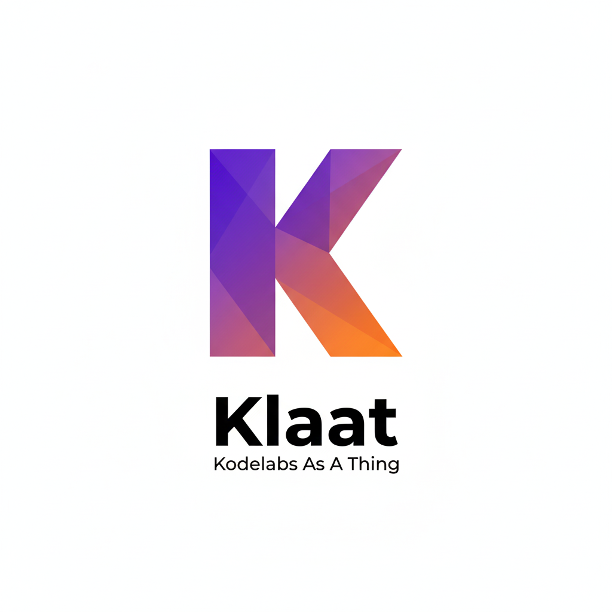

# Klaat Feature Showcase & Interactive Demo

## Overview & Metadata
Duration: 0:01:00

Welcome to the **Klaat Feature Showcase**! This tutorial serves as a living, interactive demonstration of all the markdown features, custom components, typography styles, and design system elements supported by Klaat.

### What You'll Explore

In this codelab, each step is dedicated to a distinct capability:

1. **Typography & Formatting**: Fluid headings, weights, blockquotes, and inline styling.
2. **Semantic Infoboxes**: Five distinct alert callouts (Info, Tip, Warning, Critical, Neutral).
3. **Code Highlighting & Copying**: Multi-language blocks, filenames, and copy-to-clipboard.
4. **Action Buttons**: Modern rounded pill buttons with hover animations.
5. **Tables & Structured Data**: Styled tables with code tags, alignment, and metrics.
6. **List Hierarchies**: Ordered, unordered, nested, and alphabetized lists.
7. **Interactive Surveys**: Embedded knowledge checks with custom radio selectors.
8. **Images & Visual Assets**: High-resolution image galleries and responsive scaling.
9. **Video Embedding**: Seamless YouTube embeds with responsive 16:9 aspect ratios.
10. **Complete Source Markdown**: View and copy the raw source markdown behind this showcase.

```bash
# Export this tutorial with Klaat CLI
klaat export examples/feature-showcase.md
```

Positive
: **Tip**: Look at the drawer on the left. Notice how each step automatically tracks your reading progress and estimates time remaining dynamically!

---

## Typography & Inline Styling
Duration: 0:02:00

Klaat is built on the `@kartikarora` brand design system, featuring **Readex Pro** for sans-serif prose and **JetBrains Mono** for code.

### Heading Hierarchy

Headings scale smoothly using fluid clamp tokens:

### Subsection Heading (H3)
Used for primary sub-topics and conceptual divisions.

#### Minor Heading (H4)
Used for granular steps, technical notes, or component properties.

---

### Text Formatting & Emphasis

You can emphasize text using standard Markdown constructs:

- **Bold Text**: Use `**text**` to indicate strong importance or key terms.
- *Italic Text*: Use `*text*` or `_text_` for subtle emphasis or definitions.
- ***Bold & Italic***: Combine them for maximum contrast.
- ~~Strikethrough~~: Use `~~text~~` to indicate deprecated flags or legacy syntax.
- `Inline Code`: Use backticks for CLI commands, variables like `val codelab = Exporter.parse()`, or file paths like `src/main/resources`.

---

### High-Impact Blockquotes

Blockquotes are styled with the brand's accent border and subtle background tint:

> "Klaat enables technical writers, software engineers, and educators to craft polished, interactive codelabs from markdown or Google Docs with zero friction."

---

## Semantic Infoboxes (Asides)
Duration: 0:02:00

Klaat supports five semantic infobox styles, perfect for callouts, tips, cautions, and critical alerts.

### 1. Special / Info (Blue)
Use for general informational callouts, links, or context.

Positive
: **Information**: This is a blue information box. Use it to highlight interesting facts or background context.

---

### 2. Success / Tip (Green)
Use for best practices, success confirmations, or helpful hints.

Positive
: **Best Practice**: Running `klaat serve` starts a local Ktor web server with live reloading and auto-browser launching.

---

### 3. Warning / Note (Amber)
Use to draw attention to common pitfalls or important requirements.

Negative
: **Caution**: Make sure `gcp_credentials.json` is never committed to your public Git repository.

---

### 4. Critical / Danger (Red)
Use for breaking changes, security warnings, or destructive actions.

Negative
: **Security Alert**: Modifying production bucket permissions will immediately invalidate public asset delivery.

---

### 5. Default / Neutral (Gray)
Use for standard notes that don't require an alert state.

Positive
: **Note**: All infoboxes are responsive and adapt seamlessly across Light and Dark system themes.

---

## Code Blocks & Syntax Highlighting
Duration: 0:02:00

Klaat provides syntax highlighting for all major programming languages, complete with filename tags and an interactive copy button.

### Kotlin Service Implementation

```kotlin:CodelabExporter.kt
package me.kartikarora.klaat.core

import me.kartikarora.klaat.parser.MarkdownParser
import me.kartikarora.klaat.renderer.HtmlRenderer
import java.io.File

class CodelabExporter(private val targetDir: File) {
    fun export(source: File): File {
        val codelab = MarkdownParser().parse(source)
        val rendered = HtmlRenderer.render(codelab)
        val output = File(targetDir, "${codelab.id}/index.html")
        output.parentFile.mkdirs()
        output.writeText(rendered)
        return output
    }
}
```

---

### JSON Configuration

```json:wrangler.jsonc
{
  "name": "klaat-cdn",
  "compatibility_date": "2026-08-18",
  "r2_buckets": [
    {
      "binding": "DISTRIBUTE_BUCKET",
      "bucket_name": "distribute-cdn"
    }
  ]
}
```

---

### Shell / Bash Command

```bash
# Build native binary and test locally
./gradlew nativeCompile
./build/native/nativeCompile/klaat --help
```

---

## Action Buttons & Interactive Links
Duration: 0:01:30

Download buttons and call-to-actions are styled as brand pill buttons with hover elevation and glow effects.

### Primary Action Button

Download the sample codelab starter project:

[Download Starter Kit](https://github.com/kartikarora/klaat/archive/refs/heads/develop.zip){.button}

---

### Secondary Action Button

View the source repository on GitHub:

[Browse GitHub Repository](https://github.com/kartikarora/klaat){.button}

---

### External Navigation Links

Links inside paragraphs automatically receive brand accent colors and hover transitions:
- Visit the official [Klaat Documentation](https://klaat.kartikarora.me/docs/index.html).
- Explore the [@kartikarora Brand Design System](https://distribute.kartikarora.me/css/kartikarora.1.7.0.css).

---

## Tables & Structured Data
Duration: 0:01:30

Markdown tables feature clean border dividers, subtle header backgrounds, and monospace formatting for technical specifications.

### CLI Command Reference

| Command | Arguments / Flags | Output Format | Description |
| :--- | :--- | :--- | :--- |
| `export` | `-f html -o output <src>` | HTML / Web Components | Converts source Markdown or Google Doc to a web tutorial. |
| `serve` | `-d output -p 9090` | HTTP Web Server | Hosts codelabs locally with live browser preview. |
| `update` | `-d output` | Refresh Sources | Re-fetches and updates existing Google Doc codelabs. |
| `version` | `--format json` | Console Text / JSON | Displays build variant, GraalVM version, and metadata. |

---

### Semantic Infobox Token Reference

| Variant | Border Color (Light) | Background Color (Light) | Recommended Usage |
| :--- | :--- | :--- | :--- |
| **Special** | `#1A73E8` (Blue) | `#E8F0FE` | General information, context, side-notes |
| **Positive** | `#1E8E3E` (Green) | `#E6F4EA` | Tips, best practices, success milestones |
| **Warning** | `#EA8600` (Amber) | `#FEF7E0` | Cautions, deprecations, performance notes |
| **Critical** | `#D93025` (Red) | `#FCE8E6` | Breaking changes, security alerts, errors |
| **Default** | `#808080` (Gray) | `#F1F3F4` | Neutral observations |

---

## Lists & Nested Task Hierarchies
Duration: 0:01:30

Klaat handles unordered, ordered, mixed, and multi-level nested lists with consistent indentation and typography.

### Unordered Feature Checklist

* **Zero Native Dependencies**:
  * Compiled directly to native machine code with GraalVM
  * Sub-millisecond startup times
  * Low memory footprint under 30MB
* **Extensible Architecture**:
  * Pluggable Markdown and Google Docs parsers
  * Standalone HTML, pure Markdown, and offline package renderers
* **Theme-Aware Styling**:
  * Automatic dark mode adaptation
  * Modern CSS custom properties

---

### Multi-Step Deployment Workflow

1. Author your tutorial in Markdown or Google Docs:
   1. Set required frontmatter metadata (`id`, `summary`, `authors`)
   2. Organize content into level-2 headings (`## Step Title`)
   3. Assign duration for each step (`Duration: 5`)
2. Export with the Klaat CLI:
   ```bash
   klaat export -o output tutorial.md
   ```
3. Preview locally:
   ```bash
   klaat serve -d output
   ```
4. Deploy to your preferred web host or Cloudflare Pages.

---

## Interactive Knowledge Check (Surveys)
Duration: 0:01:30

Engage readers with embedded multiple-choice quizzes and survey checkpoints directly in the flow of the tutorial.

### Quick Knowledge Check

Which command is used to start the built-in preview server in Klaat?

- [ ] `klaat export --preview`
- [x] `klaat serve -d output`
- [ ] `klaat run-server`
- [ ] `klaat preview tutorial.md`

Positive
: **Correct!** `klaat serve` starts the built-in Ktor preview server, serving all codelabs from your output directory.

---

## Images & Visual Assets
Duration: 0:01:30

Images in Klaat are centered by default, responsive to mobile screen sizes, and styled with subtle border radii.

### Responsive Image with Caption



### Markdown Image Syntax

You can include images stored locally relative to your Markdown file or hosted remotely on a CDN:

```markdown

```

Positive
: **Automatic Image Extraction**: When exporting from Google Docs, Klaat automatically downloads all embedded drawings and screenshots into an `images/` directory alongside your generated HTML.

---

## Video Embedding (YouTube)
Duration: 0:01:30

Klaat makes embedding video tutorials effortless. Simply paste a standard YouTube video URL on its own line:

### Responsive 16:9 Video Player

https://www.youtube.com/watch?v=dQw4w9WgXcQ

---

### Supported Video Formats & Syntax

You can embed YouTube videos using either standard watch URLs or shortened share links:

- `https://www.youtube.com/watch?v=VIDEO_ID`
- `https://youtu.be/VIDEO_ID`

Klaat automatically converts YouTube URLs into an accessible, responsive `<iframe>` player that adapts fluidly across mobile, tablet, and desktop screens with a perfect 16:9 aspect ratio.

```markdown
# To embed a video, simply paste the URL on its own line:
https://www.youtube.com/watch?v=dQw4w9WgXcQ
```

Positive
: **Zero Configuration**: No complex HTML embed codes or JavaScript widget scripts are needed.

---

## Complete Source Markdown
Duration: 0:03:00

Below is the complete, raw Markdown source used to produce this interactive codelab. You can use the copy button in the top right corner to copy the full template for your own projects:

```markdown:examples/feature-showcase.md
---
id: klaat-feature-showcase
summary: A comprehensive, interactive tour showcasing all rich elements, typography, code blocks, infoboxes, surveys, and media supported by Klaat.
authors: Kartik Arora
categories: demo, markdown, kotlin, tutorial
environments: web
status: published
feedback_link: https://github.com/kartikarora/klaat/issues
tags: demo, features, components, markdown, showcase, video, youtube
duration: 20
---

# Klaat Feature Showcase & Interactive Demo

## Overview & Metadata
Duration: 0:01:00

Welcome to the **Klaat Feature Showcase**!

## Typography & Inline Styling
Duration: 0:02:00

### Subsection Heading (H3)
#### Minor Heading (H4)

- **Bold Text**: `**text**`
- *Italic Text*: `*text*`
- `Inline Code`: backticks
> "High impact pull quote"

## Semantic Infoboxes (Asides)
Duration: 0:02:00

Positive
: **Information**: Blue info box.

Positive
: **Best Practice**: Green tip box.

Negative
: **Caution**: Amber warning box.

Negative
: **Security Alert**: Red critical alert box.

## Code Blocks & Syntax Highlighting
Duration: 0:02:00

\```kotlin:CodelabExporter.kt
package me.kartikarora.klaat.core
class CodelabExporter(private val targetDir: File)
\```

## Action Buttons & Interactive Links
Duration: 0:01:30

[Download Starter Kit](https://github.com/kartikarora/klaat){.button}

## Tables & Structured Data
Duration: 0:01:30

| Command | Arguments | Format |
| :--- | :--- | :--- |
| `export` | `-f html -o output` | HTML |

## Lists & Nested Task Hierarchies
Duration: 0:01:30

* Feature Item 1
  * Sub Item 1.1
1. Step One
2. Step Two

## Interactive Knowledge Check (Surveys)
Duration: 0:01:30

### Quick Knowledge Check
Which command starts preview?
- [ ] `klaat export --preview`
- [x] `klaat serve -d output`

## Images & Visual Assets
Duration: 0:01:30


## Video Embedding (YouTube)
Duration: 0:01:30

https://www.youtube.com/watch?v=dQw4w9WgXcQ
```

---

## Summary & Next Steps
Duration: 0:01:00

Congratulations! You have completed the **Klaat Feature Showcase**.

### What You Explored
- ✅ Frontmatter metadata and dynamic drawer duration calculation
- ✅ Fluid typography with Readex Pro and JetBrains Mono
- ✅ All 5 semantic aside infobox styles (Info, Tip, Warning, Critical, Neutral)
- ✅ Multi-language syntax highlighting with filename pills and copy buttons
- ✅ Rounded action buttons and navigation styling
- ✅ Clean tabular data layouts
- ✅ Nested list hierarchies
- ✅ Interactive surveys and knowledge check blocks
- ✅ Responsive images with automatic Google Docs extraction
- ✅ Seamless YouTube video embeds with responsive 16:9 aspect ratios
- ✅ Complete source Markdown template with one-click copy

### Next Steps
- 📖 Read the complete [Klaat Documentation](https://klaat.kartikarora.me/docs/index.html)
- 🚀 Install Klaat skills for your AI agent with `klaat install-skills`
- ⭐ Star the project on [GitHub](https://github.com/kartikarora/klaat)
